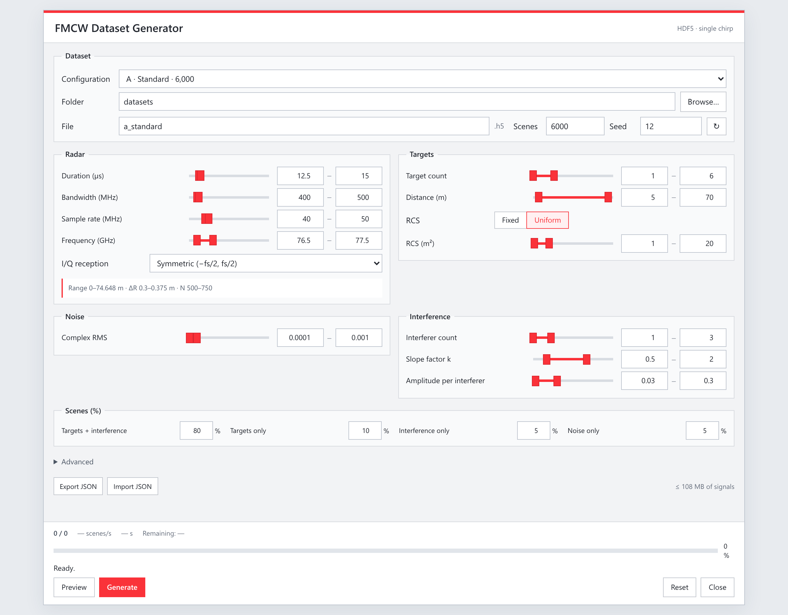

# FMCW Mitigation and Detection

Code and data for **FMCW Interference Mitigation and Weak Target Detection
across Radar Configurations**.



Configure radar, targets, noise and interference, load seeded presets, and preview signals before HDF5 export.

## Contents

- **[dataset/](dataset/README.md)** — datasets, red graphical generator, configurations and fixed splits.
- **[training/](training/README.md)** — training code, training/inference notebooks and epoch-120 weights.

Graphical dataset generator:

```bash
python -m pip install -r dataset/requirements.txt
python dataset/launch.py --browser
```

Model inference:

```bash
python -m pip install -r training/requirements.txt
python training/infer.py
```

Open `training/Inference.ipynb` for inference plots, or
`training/Training.ipynb` to train a new model locally or on Colab.
The model takes one complex chirp and known radar parameters, and returns
presence scores and an optional complex reconstruction.

The supplied weights are from **epoch 120**, selected by validation loss.
They include the validation-selected presence threshold **0.6254660674**.
Internal/external recall is 94.29%/95.64%, with 0.0072/0.0135 false detections
per chirp. At the fixed training threshold 0.5, recall is 95.38%/96.51%.
These are secondary evaluations on previously inspected simulated test sets.

There are 24,000 main scenes (16,795 training, 3,596 validation, 3,609 internal
test) and 6,000 external scenes. All signals are simulated. The external data
have already been used for evaluation; use new independent scenes for new
confirmatory tests after further model development.

## Download the datasets

- [Main dataset: principal.zip](https://github.com/walidhirouche/fmcw-mitigation-detection/releases/download/datasets-v1/principal.zip)
- [External dataset: externe.zip](https://github.com/walidhirouche/fmcw-mitigation-detection/releases/download/datasets-v1/externe.zip)

Place both archives in `dataset/`, without extracting them. The notebooks read
them directly. Code, notebooks and trained weights are included in the repository;
the larger datasets are release downloads.
